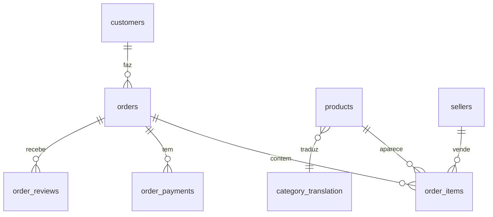
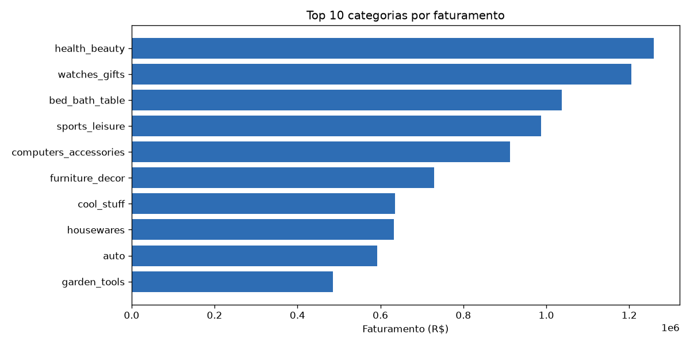
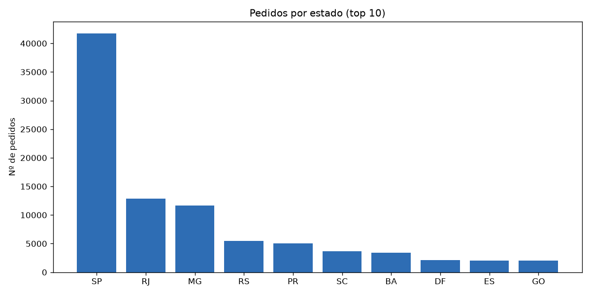
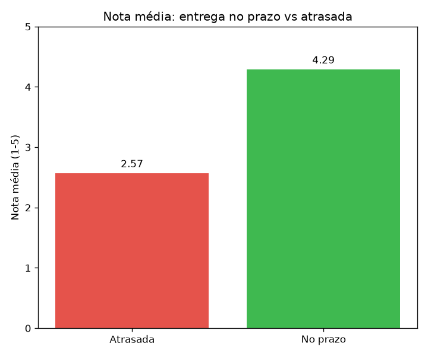

# 🛒 Análise de E-commerce com SQL — Dataset Olist

Análise exploratória do maior dataset público de e-commerce brasileiro (Olist), usando **SQL** sobre um banco **SQLite** e visualização em Python. O projeto modela os dados, carrega ~1,5 milhão de registros e responde perguntas de negócio reais com consultas SQL.

---

## 📋 Sobre o projeto

O dataset Olist contém dados reais de ~100 mil pedidos de um marketplace brasileiro (2016–2018): clientes, produtos, vendedores, pagamentos, avaliações e entregas, distribuídos em 9 tabelas relacionadas.

O objetivo foi praticar **modelagem relacional e SQL analítico** de ponta a ponta: do CSV bruto ao insight visual.

Fonte dos dados: [Brazilian E-Commerce Public Dataset by Olist (Kaggle)](https://www.kaggle.com/datasets/olistbr/brazilian-ecommerce)

---

## 🗄️ Modelagem

As tabelas se relacionam em torno do **pedido** (`orders`), em relações um-para-muitos:



A chave que liga a maior parte das consultas é o `order_id`; as demais pontes são `customer_id`, `product_id` e `seller_id`.

---

## 🔍 Principais insights

### 1. Categorias que mais faturam
Beleza & saúde, relógios/presentes e cama/mesa/banho lideram o faturamento.



### 2. Concentração geográfica
São Paulo sozinho responde por mais pedidos que todos os outros estados somados — forte concentração no Sudeste.



### 3. Atraso na entrega x satisfação (o achado principal)
Pedidos entregues **no prazo** têm nota média **4,29**. Os **atrasados** despencam para **2,57** — uma queda de ~40%.



> **Recomendação de negócio:** investir em logística e cumprimento de prazo tem impacto direto na avaliação dos clientes — e, consequentemente, na reputação do marketplace.

---

## 🛠️ Técnicas de SQL aplicadas

- **JOINs** entre múltiplas tabelas (`order_items`, `products`, `orders`, `customers`, `category_translation`)
- **Agregações** com `GROUP BY`, `SUM`, `AVG`, `COUNT`
- **Lógica condicional** com `CASE WHEN` (classificar entrega em prazo/atrasada)
- **Filtros** com `WHERE`
- **VIEW** (`vendas_completa`) para reutilizar consultas complexas
- **Índices** para acelerar JOINs e filtros nas colunas-chave

---

## 🚀 Como rodar

```bash
# 1. Clonar
git clone https://github.com/shiionn21/olist-analise-sql.git
cd olist-analise-sql

# 2. Baixar o dataset do Kaggle e colocar os CSVs em uma pasta 'dados/'

# 3. Ambiente virtual + dependências
python -m venv venv
.\venv\Scripts\activate
pip install -r requirements.txt

# 4. Rodar o pipeline
python carregar_banco.py     # cria o banco olist.db e importa os CSVs
python criar_estrutura.py    # cria a view e os índices
python graficos.py           # gera os gráficos em 'graficos/'
```

---

## 📁 Estrutura

```
olist-analise-sql/
├── dados/                 # CSVs do Olist (baixados do Kaggle)
├── graficos/              # gráficos gerados
├── explorar.py            # inspeciona as tabelas
├── carregar_banco.py      # importa os CSVs para o SQLite
├── criar_estrutura.py     # cria view e índices
├── consultar.py           # executa as consultas SQL
├── graficos.py            # gera as visualizações
└── requirements.txt
```

---

## 🧰 Tecnologias

- **SQL** (SQLite)
- **Python** — pandas, matplotlib
- **sqlite3** (embutido no Python)

---

## 🗺️ Próximos passos

- [ ] Analisar sazonalidade (faturamento por mês/ano).
- [ ] Incluir a tabela de geolocalização para análise de distância x frete.
- [ ] Migrar o banco para PostgreSQL.
- [ ] Transformar as análises em um dashboard interativo.

---

## 👤 Autor

**Anderson Souza** — Estudante de Análise e Desenvolvimento de Sistemas.

- GitHub: [@shiionn21](https://github.com/shiionn21)
